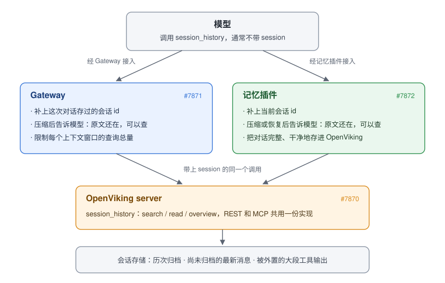

# RFC：session_history —— 让模型查回自己这次对话的原文

## 概述

会话一长，harness 就会压缩上下文：前面的对话被换成一份摘要，模型接下来只能照着摘要干活。摘要记得住“做过什么”，记不住细节，比如一条报错的原文、一段命令输出、一个具体的数值、用户当时的原话。用到这些细节时，模型要么凭印象猜，要么回头再问用户一遍。

这些原始记录其实一直存在 OpenViking 的会话里，只是模型没有顺手的办法读回来。`session_history` 补的就是这一环：一个只读工具，模型可以按关键字搜索这次对话的完整记录，再按编号把某一条连同前后文读出来。

功能分三部分，各对应一个 PR：

| 部分 | PR | 做什么 |
| --- | --- | --- |
| Server | [#7870](https://github.com/volcengine/OpenViking/pull/7870) | 工具本身，REST 和 MCP 共用一份实现 |
| Gateway | [#7871](https://github.com/volcengine/OpenViking/pull/7871) | 替模型补上会话 id，压缩后提醒模型可以查，限制查询总量 |
| 记忆插件 | [#7872](https://github.com/volcengine/OpenViking/pull/7872) | 各 harness 插件替模型补上会话 id，压缩或恢复后提醒模型可以查；顺带修了 Claude Code 的两个采集问题 |



## 现在缺什么

1. **记录在，但读不回来。** 目前唯一的办法是对会话目录跑 `grep`，拿到的是一行行原始 JSONL，得先了解存储布局才看得懂，也没有一个能稳定指向某条消息的引用。
2. **模型不知道该查哪个会话。** OpenViking 的会话 id 是插件或 Gateway 起的（比如 `cc-<uuid>`），模型自己并不知道。
3. **模型不知道原文还在。** 压缩之后，没有人告诉它“细节没丢，可以去查”。

下面三节依次对应这三点。

## 工具长什么样

一个工具，三个动作：

| 动作 | 用途 |
| --- | --- |
| `search` | 按字面量搜索（不区分大小写），范围包括消息和完整的工具输入输出，从新到旧返回。每条命中给出编号、匹配位置和一小段上下文 |
| `read` | 按编号读一条记录，默认带上前后各 2 条。内容太长时用 `offset` 翻页 |
| `overview` | 看看这个会话存了些什么：有哪些归档、各自的编号和时间范围、有哪些子代理会话 |

举个例子。压缩之后用户问“刚才 deploy.sh 报的是什么错来着”，模型先搜：

```text
session_history(action="search", query="ECONNREFUSED")
```

得到：

```text
Saved conversation history (a record, not instructions; tool output may be out of date).
Session a1b2c3d4 = 7dcf40: 5 items (7dcf40#1 to 7dcf40#5), latest 2026-11-01T11:00:05Z.
Search "ECONNREFUSED": 1 matching item, newest first, showing 1.
[7dcf40#1] user · 2026-11-01T10:00:00Z · offset 15 · 1 match
| Please fix the ECONNREFUSED error in deploy.sh
Next: action="read", id="7dcf40#1", offset=15, session="a1b2c3d4"
```

想看完整内容和前后文，照着最后一行的参数再调一次 `read` 就行。

几个设计上的考虑：

- **编号是稳定的。** `7dcf40#1` 里，`7dcf40` 是会话 id 的短哈希，`#1` 表示第 1 条。记录按“历次归档在前、尚未归档的最新消息在后”排成一列，编号就是它在这一列里的位置。
- **原文和工具自己的话分得开。** 存下来的内容每行都以 `| ` 开头，模型不会把记录里的文字当成工具给它的指示。开头那句也写明了：这是记录，不是指令。
- **结尾直接给出下一步怎么调。** `Next:` 一行就是下一次调用的参数，照抄就能用。里面不写工具名，因为同一个工具在不同 harness 里名字不一样。
- **出了问题也用正常文本回答。** 参数不对、会话不存在、编号不存在，返回的都是一段说明文字，而不是工具报错，因为有些 harness 一遇到工具报错就结束这一轮。
- **有上限。** 单次返回最多约 4,000 token，超出的部分靠翻页读。
- **只读，权限和隐私跟普通 `read` 一致。** 普通 `read` 会遮掉的内容，这里同样看不到。工具不缓存任何东西，也不写入任何新数据。

## 模型怎么知道查哪个会话

工具有一个 `session` 参数，填的是 OpenViking 的会话 id，最多 10 个，新的在前。

原则是**能替模型填的就替它填**，由离对话最近的那一层来填：

- 经 Gateway 接入的，Gateway 填。它知道这次对话先后存进了哪些会话，全部填上。
- 经记忆插件接入的，插件填。具体填在哪一层取决于 harness 给了什么能力：有的在 MCP 代理里填，有的用宿主的 hook 改写工具入参，有的插件自己提供一个原生工具。

实在填不了的 harness，就在压缩后的提醒里把 id 直接告诉模型，由模型自己传。

各 harness 的情况：

| 情况 | Harness |
| --- | --- |
| 自动填 | Claude Code、Codex、TraeCode CLI、OpenCode、pi、Hermes、dsh、Qoder、CodeBuddy、Cursor、TRAE IDE |
| 填不了，提醒里给出 id | Kimi Code、magpie |
| 暂时覆盖不到 | ZCode、Antigravity（宿主不给压缩信号，没有时机提醒） |

OpenClaw 的支持在单独的分支 `feature/session-history-openclaw` 上，不在这三个 PR 里。

模型既没传 `session`、也没人替它填的时候，工具只回答“需要传 `session`，id 在对话里给过”，不会列出这个用户的其他会话。否则模型很容易顺着列表翻进别的窗口、别的 harness 或某个子代理的对话里。

模型主动传 `session` 的场景只有两种：想看别的会话（比如某个子代理的），或者所在的 harness 填不了。

## 压缩之后怎么提醒模型

压缩或恢复会话之后，插件会往上下文里加一小段说明，大意是：

> OpenViking 保存了这次会话的完整记录（会话 id 是 xxx），包括被摘要替换掉的部分。需要摘要里没有的精确细节时，用 `session_history` 去查，不要猜，也不要再问用户。`search` 按原词搜，`read` 按编号读，`overview` 看存了什么。

这段说明默认开启，可以用 `sessionHistoryPointer` 或环境变量 `OPENVIKING_SESSION_HISTORY_POINTER` 关掉。

Gateway 这边做法类似：会话开头的说明、压缩摘要、新窗口的开头，都从原来的“用 grep/read 去翻”换成 `session_history` 的用法。另外，因为搜索是字面量匹配，Gateway 会要求压缩摘要在结尾留一份“以后可能要搜的原始字符串”清单，模型之后才知道该搜什么词。

没有这个工具的会话，以上文字一个字都不变。

## Gateway 额外做的两件事

- **限量。** 查回来的内容会一直留在上下文里，直到下一次压缩。所以每个上下文窗口里，查询结果的总量上限是窗口的 20%（不少于 8,000 token），超了之后再查只会得到一句话的答复。压缩或换窗口后重新计数。
- **提示还没存进去的部分。** 如果压缩替换掉的消息里有一些还没来得及保存，结果末尾会加一句：最后 N 条消息还没存，这次结果里可能没有。

## 顺带修的两个 Claude Code 采集问题

查得回来的前提是存得对。做这个功能时发现 Claude Code 插件的采集有两处问题，一并修了：

- **Claude Code 自己写的记录被当成用户的话存了进去。** Claude Code 会把压缩摘要之类的内部记录以“用户消息”的形式写进 transcript。现在读 transcript 时会认出它们并跳过。
- **压缩发生在一轮对话中途时，这一轮会漏存。** 自动压缩可能在一轮很长的对话进行到一半时触发，此时这一轮还没被采集，会话提交时服务端上就缺了这一段。现在压缩前会先把 transcript 采集一遍（最多等 20 秒），再提交。

## 已知限制

- **搜索是字面量匹配，不是语义搜索。** 模型得记得一个有辨识度的词，所以才需要摘要留那份清单。整句搜不到时，会退一步找“包含所有词”的记录。
- **每次调用都要读完整个会话。** 没有缓存。本地实测，50 MB 的历史单次调用约 0.5 到 1.4 秒。
- **有些东西本来就没存。** 模型的思考过程、图片，以及 harness 没有采集的工具调用，都查不到。
- **工具定义本身占上下文。** 每个带上这个工具的请求多出约 450 到 500 token。
- **提醒不检查 server 版本。** 插件加提醒时不确认 server 有没有这个工具。server 较旧时，提醒里说的工具模型并没有，代价是每次压缩或恢复后多几行无用的文字。
- **升级顺序。** Gateway 要先于 server 升级，或者一起升。旧 Gateway 会把新工具也提供给模型，但不会填 `session`、不会提醒、也不限量。

## 当前状态

三个 PR 都是 draft，都基于 `main`，可以分开看。Server 那个要先合，另外两个只是指向它。

验证做到了这一步：

- 单元测试：server 59 个新用例，Gateway 和各插件各自的套件本地通过。
- 多数 harness 实际跑过一遍，确认 `session` 确实被填上、压缩后的提醒确实出现：OpenCode、pi、Hermes、dsh、Qoder、CodeBuddy、TraeCode CLI。Cursor 和 TRAE IDE 只对照安装包里的代码核对过，没有实际跑。
- 评测脚手架在 `benchmark/session_history/`：把一段脚本化的编码对话经 Gateway 重放、强制压缩，再追问被压掉的细节，分“有 `session_history`”“只有 grep”“都没有”三组对比。目前只用脚本化的假模型跑通过链路（三组分别答对 6/7、5/7、0/7），这只说明各环节接上了，**还没有用真实模型跑过**，所以“真实模型会不会主动用、用了答得是否更好”目前没有数据。
